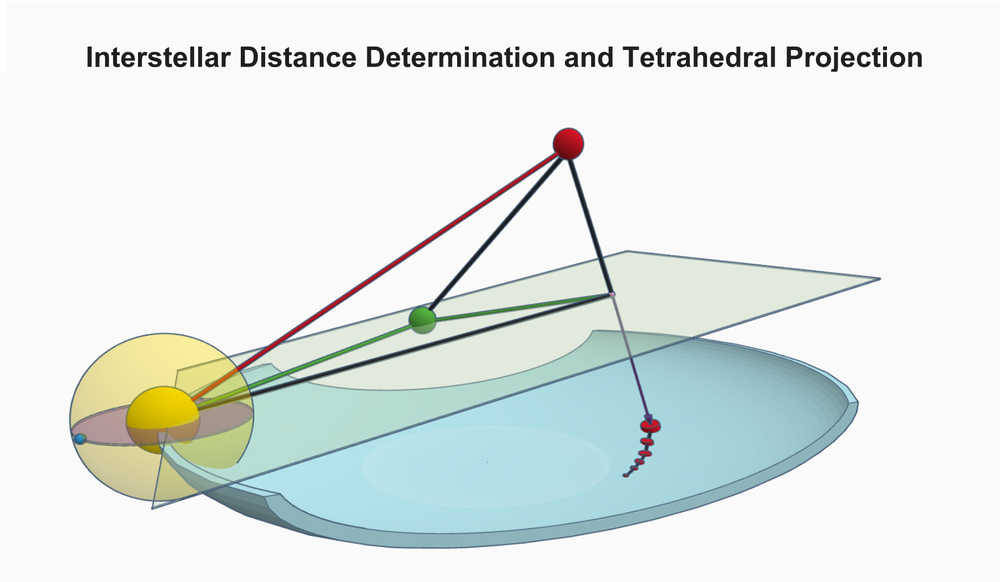

**Interstellar Distance Determination and Tetrahedral Projection**

A Method for Cosmic Trigonometric Distance Calculations.

Proposed Method for Stellar Distance Calculations and Amplified Star Tracing.

Jason Webb Independent Researcher ORCID: [https://orcid.org/0009-0005-8903-8607](https://orcid.org/0009-0005-8903-8607)

## October 2026 DOI: [https://doi.org/10.5281/zenodo.20554128](https://doi.org/10.5281/zenodo.20554128)

# Repository Purpose

This repository contains the primary technical document, supporting diagrams and licensing information associated with this research project.

# Items in this repository

## Primary Publication

47A-cosmic-trigonometric-distance-calculations-v1.0.0.pdf

## Supporting Documents

├── document-portrait/ \# An alternative copy of the main PDF document, figures in portrait.

├── figures-diagrams/   \#  Copies of PDF diagrams-figures in Vector and PNG.

│   ├── vector/             \#  Copies of PDF Vector diagrams.

│   ├── png/                \#  Copies of PDF Figures (PNG Images).

├── README.md          \# Project landing page documentation

└── LICENSE.md          \# Open-source license terms

# Citation

If you use or reference this work, please cite using the following.

Webb, J. (2026). Interstellar Distance Determination and Tetrahedral Projection. Licensed under CC BY 4.0. ORCiD: [https://orcid.org/0009-0005-8903-8607](https://orcid.org/0009-0005-8903-8607)

# License

This work is licensed under the Creative Commons Attribution 4.0 International License (CC BY 4.0).

[https://creativecommons.org/licenses/by/4.0/](https://creativecommons.org/licenses/by/4.0/)

